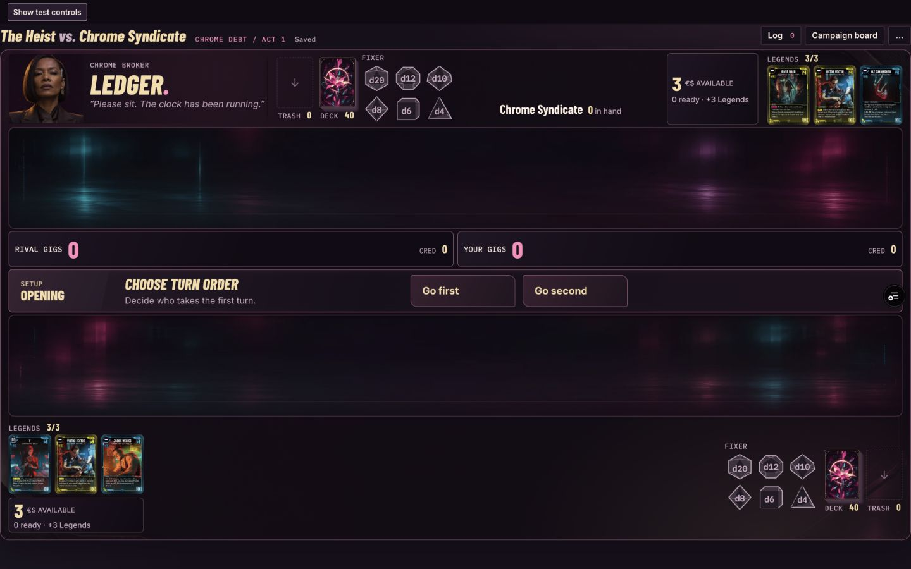
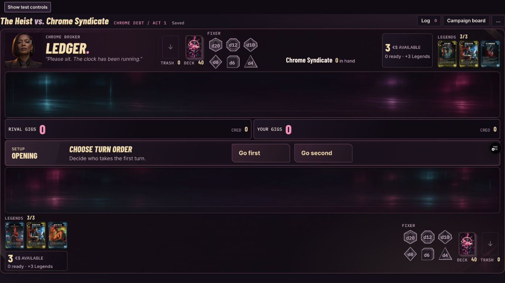

# Contextual decision bar

The command bar now presents the current engine decision with a compact phase plate, a clear instruction and grouped actions. Turn-order choices have matching 150–180 × 50 px buttons, restrained plum lighting and no default emphasis. Opening-hand, Gig, payment, targeting, combat and effect prompts share the same presentation model. Ordinary turns and resolution remain quieter.

## Implementation boundaries

- `commandPresentation` reads the existing prompt, legal actions and active selection step. It does not determine legality or introduce gameplay state.
- Cancel, Clear, Decline and Pass remain separate controls with their existing handlers. Passing a reaction is available while selecting a blocker or another reaction action.
- New mandatory prompts receive a 260 ms border cue. Local target selections do not restart it; reduced motion disables it. Eligible dice have a static highlight.
- Complex combat context and payment information share a supporting row. Card-placement review sits beside the options when space allows. All options, details, counts and ordering controls remain available.
- No rules, AI, probabilities, audio, campaign progression or production persistence were changed.

## Automated verification

`npm run check`: 465 tests across 43 files, lint, TypeScript and production build pass. `git diff --check` passes. The existing large-chunk build advisory remains.

The new tests cover translated action labels, mandatory versus voluntary payment, direct card-type/destination instructions, reactions, resolution precedence, optional effects, entrance cue stability and attack steps. Eleven preview positions construct and validate real engine prompts.

## Browser verification

Used `campaign-preview.html?decisions`, with isolated `qa:command-bar` saves and the actual PlayTable, engine and move playback. The preview entry is excluded from production output.

| Check | Observed result |
| --- | --- |
| 1366×768, 1440×900, 1920×1080 | Equal turn-order controls, readable headings, no horizontal overflow or field overlap. Setup bar stays 68 px high. |
| Turn order | Go first through Enter and Go second through Space both advance correctly. |
| Opening hand | Keep and Mulligan both work with the existing deal/mulligan flow. |
| Gigs | Selection count changes from 0/1 to 1/1; confirmation enables. Dragging d12 onto the field rolls it and returns to normal play. |
| Payment | Cancel returns to normal play. Removing a payment source disables confirmation. Refresh restores 3/4 sources; completing payment plays the card and spends the sources. |
| Combat | Attacker/target instructions, legal target highlights, direct blocking, pass reaction, protection payment and decline all use the real engine. |
| Chained effects | Two Misty triggers resolve in sequence, including both card-type choices, before the rival turn starts. |
| Card placement | Revealed cards, required count, inspection and placement review remain available; selecting and placing a card resolves normally. |
| Additional states | Forced Floor It target, overtime, move playback, campaign result and Free Play presentation checked. |
| Accessibility | Keyboard activation, visible focus, semantic labels and reduced-motion rendering checked. |

Long effect choices can require vertical scrolling on a short laptop viewport; controls remain in document flow and do not overlay either field.

## Screenshots

1440×900:

1366×768:

