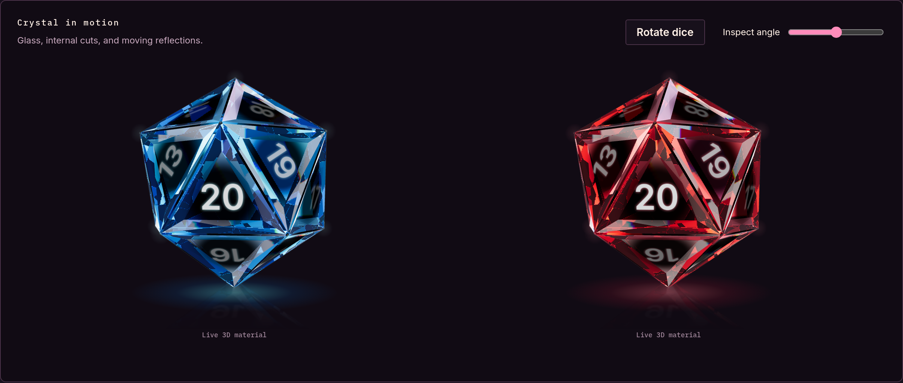

# Crystal d20 material proof

Open `campaign-preview.html?dice-proof` in the local-only dev server. The page is also included in preview builds, and is excluded from production builds. It compares the previous procedural icons with the new blue/player and red/rival artwork, shows board-sized labels, and provides two live d20s with rotation and angle controls.

## Artwork

`src/assets/play/dice/crystal-d20-proof.png` is the original 1536 × 1024 transparent image generated for this proof from the user's crystal-dice direction. The brief called for sapphire and ruby d20 silhouettes, dark blank number wells, thick layered crystal cuts, fine internal reflections, and selective white highlights. It contains two adjacent icons, blue on the left and red on the right. CSS crops each half; numbers remain live text and are not baked into the artwork.

The production set uses twelve transparent 256 px WebP assets. The two d20s come from the approved proof. The d4, d6, d8, d10 and d12 were generated together from that proof and exported individually. Board labels use the die type or the current public value. Each shape has distinct artwork in both ownership colors.

## Live material

`crystalRenderer.ts` builds a d20 with recessed face centers and a ring of angled cuts around each face. `crystalOptics.ts` traces up to four internal ray reflections against the convex die, with color absorption and a small spectral separation. A local studio cubemap supplies moving highlights. This is a bounded real-time approximation, not an offline path-traced gemstone or a simulation of every small cut. Number textures are rendered separately so internal reflections cannot duplicate or obscure the result.

The proof imports Three.js lazily, caps pixel density at 2, and renders only after an angle change or while visible rotation is active. Hidden tabs, offscreen dice, and reduced motion stop continuous rendering. Context failure or loss displays the new static artwork with the result. Textures, geometries, materials, render targets, listeners, and frame callbacks are released on unmount.

## Verification

- `npm ci`, `npm run check`, and `npm run check:budget`.
- `npm run test:dice`: the original collision/drag/settle checks plus material rotation, reduced motion, unavailable WebGL, and context loss.
- Visual review at 1280 px and 390 px, including old/new artwork, board sizes, and two inspection angles.

## Gameplay and profiling

The play table uses the same faceted geometry and optical shader as the proof. It leases up to two WebGL canvases during a roll. Each canvas retains its studio and last die for up to 30 seconds between throws. The landing face is selected from the saved roll every time the canvas is leased. Canvas draws the trajectory during shader preparation and handles additional dice, unavailable WebGL and context loss. Docking reveals the artwork and the public Gig value.

For a device measurement, open `/campaign-preview.html?dice&profile` on a preview build and select **Profile all dice**. Keep the tab visible. The workbench runs a first throw, repeat throw and simultaneous player/rival throw for each shape. It reports the browser, renderer string when available, viewport, pixel ratio, number of sampled flight frames and frame-interval percentiles. Record the device and GPU model alongside the JSON, particularly when the browser masks its renderer string. These intervals include browser scheduling and graphics work.

The integration was exercised locally with Chromium and SwiftShader. Physical GPU measurements in Chrome, Edge, Firefox and Safari 18+ remain pending.

The [recorded Chromium run](qa/crystal-roll-swiftshader.json) used SwiftShader at 1280 × 900 and DPR 1 on a preview build. All 18 throws reached WebGL. Across shapes, repeat throws had 95th-percentile frame intervals of 16.7–33.3 ms and pairs had 33.3–66.7 ms. The longest first-throw interval was 333.3 ms on this software renderer. These are single-run observations.
