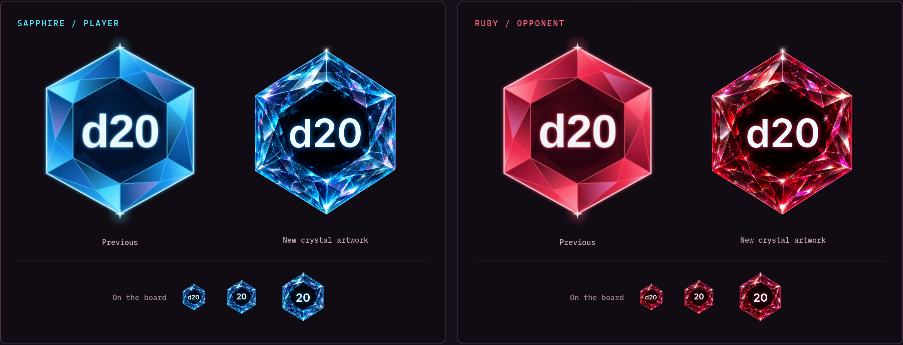

# Crystal d20 material proof

Open `campaign-preview.html?dice-proof` in the local-only dev server. The page is also included in preview builds, and is excluded from production builds. It compares the previous procedural icons with the new blue/player and red/rival artwork, shows board-sized labels, and provides two live d20s with rotation and angle controls.

## Artwork

`src/assets/play/dice/crystal-d20-proof.png` is the original 1536 × 1024 transparent image generated for this proof from the user's crystal-dice direction. The brief called for sapphire and ruby d20 silhouettes, dark blank number wells, thick layered crystal cuts, fine internal reflections, and selective white highlights. It contains two adjacent icons, blue on the left and red on the right. CSS crops each half; numbers remain live text and are not baked into the artwork.

This proof establishes the d20 art direction. The other five shapes still use the earlier procedural artwork, and the new rendering path is not yet connected to the game roll layer.

## Live material

`crystalRenderer.ts` builds a d20 with recessed face centers and a ring of angled cuts around each face. `crystalOptics.ts` traces up to four internal ray reflections against the convex die, with color absorption and a small spectral separation. A local studio cubemap supplies moving highlights. This is a bounded real-time approximation, not an offline path-traced gemstone or a simulation of every small cut. Number textures are rendered separately so internal reflections cannot duplicate or obscure the result.

The proof imports Three.js lazily, caps pixel density at 2, and renders only after an angle change or while visible rotation is active. Hidden tabs, offscreen dice, and reduced motion stop continuous rendering. Context failure or loss displays the new static artwork with the result. Textures, geometries, materials, render targets, listeners, and frame callbacks are released on unmount.

## Verification

- `npm ci`, `npm run check`, and `npm run check:budget`.
- `npm run test:dice`: the original collision/drag/settle checks plus material rotation, reduced motion, unavailable WebGL, and context loss.
- Visual review at 1280 px and 390 px, including old/new artwork, board sizes, and two inspection angles.

Headless Chromium uses software WebGL for verification. This establishes rendering and fallback behavior, not a frame-rate guarantee for real devices. Hardware profiling and full roll-layer integration remain part of extending this d20 proof to the complete set.
