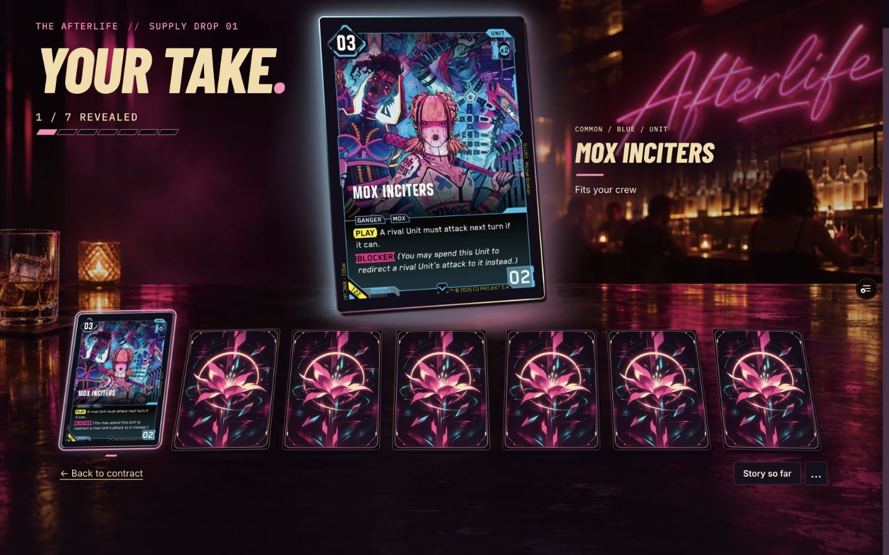
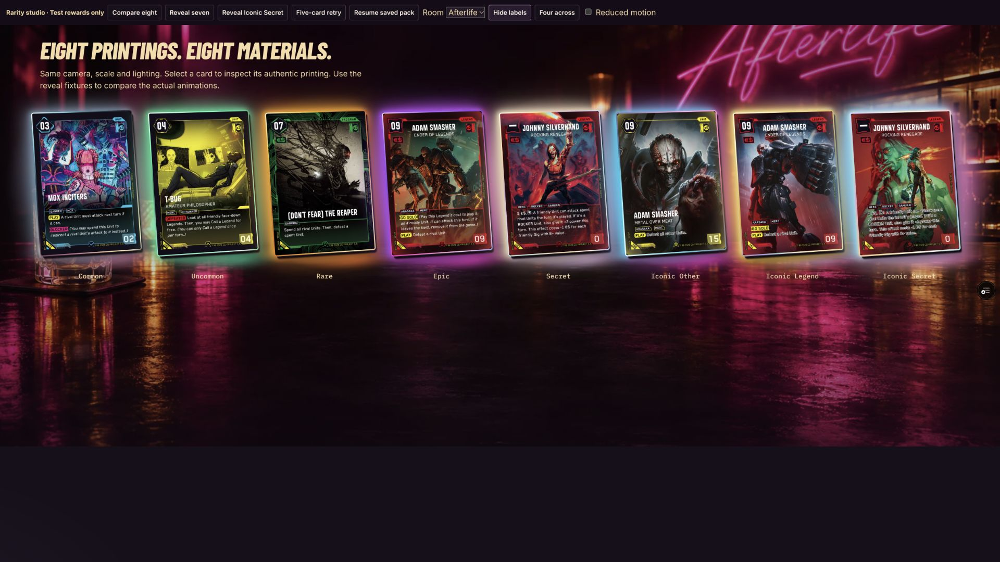

# Campaign pack materials — verification

PR: https://github.com/LeviJohnsonNC/cyberpunk-tcg-vault/pull/93

Preview: https://cyberpunk-tcg-vault-git-codex-pa-66ffec-levijohnsonncs-projects.vercel.app/campaign-preview.html?materials

## Presentation

The featured card has a perspective pose, physical edge thickness, directional rim, layered bloom, broad halo, contact shadow, tabletop spill and a short reflected image. Exact printing art remains unchanged. The follow-up increases exterior lighting substantially: saturated multi-layer bloom, wider halos, brighter tabletop pools and stronger persistent colour separation. Surface sweep opacity remains capped at 0.45 and settles to zero so artwork and rules stay readable.

| Printing rarity | Material |
| --- | --- |
| Common | Cool satin rim with the quietest halo |
| Uncommon | Luminous mint and silver |
| Rare | Saturated amber and bronze bloom |
| Epic | Broad violet/rose interference glow |
| Secret | Bright champagne pearl and lilac |
| Iconic Other | Cyan-left/magenta-right dichroic separation |
| Iconic Legend | Gold/orange bloom with violet accents |
| Iconic Secret | Platinum, cyan, pink and gold prism; widest halo |

The reveal sequence retains the physical flip and movement. Surface effects begin only after the face is exposed and its exact artwork loads. They last 480–990ms, overlap movement and settle to sustained static glow. Previously revealed cards do not replay discovery effects. The lineup uses lighter versions of the material edges; its selection outline and marker are independent of rarity. Sealed cards do not disclose their rarity.

## Stronger-glow follow-up verification

Verified application commit a659b4501fa28ddbcb8d7187febe9a9fb503e4e2 in the actual Vercel preview:

- All eight materials together at 1920×1080, both with and without labels. Mint, amber, violet, pearl, split cyan/magenta, gilded and prismatic exterior lighting remain visible at rest.
- Revealed all eight printing rarities through the production pack flow at 1440×900; inspected reveal onset/flight and settled featured-card states. The larger halo stays outside opaque card artwork.
- Seven-card reveal still reaches the bonus-card action.
- Reduced motion: Enter reveals a card immediately, discovery is absent, all material animation names are `none`, surface/glint opacity is zero, and static halo/bloom remain visible.
- 390px Common and 320px Iconic Secret views: no horizontal page overflow; horizontal lineup remains contained; controls remain accessible.
- Final browser console error check returned no errors. Temporary viewport and motion overrides were restored.
- `npm run check` passed: lint, 445 tests across 41 files, TypeScript and production build. Existing React-hook and large-chunk warnings remain.
- `git diff --check` passed; Vercel build succeeded.
- No new production image assets or dependencies; reward, save, inventory and progression logic is unchanged.

## Original material-system verification (PR 92)

Inspected actual Vercel preview UI through the connected Chrome browser:

- Common pose and lighting together at 1440×900 and 1366×768 before continuing with the material family.
- All eight rarities together at 1920×1080, with the same scale and camera; labels can be hidden.
- Actual flip, flight, material onset and resting states across all eight rarity fixtures.
- Afterlife, Rooftop and Arasaka environments.
- 1366×768, 1440×900, 1920×1080 desktop viewports.
- 390px and 320px phone viewports: no horizontal page overflow; the lineup scrolls independently and controls remain accessible.
- Repaired rectangular halo cutoffs found during the comparison.
- Repaired the reflected image transform and checked that the reflected image overlaps its masked frame.
- Final browser console error check returned no errors.

## Original interaction and regression checks (PR 92)

- Nonsequential reveals and repeated clicks: one saved reveal per slot.
- Sealed slots have no rarity/material attributes, material styles or revealing accessible labels.
- Selecting a previously revealed card clears the discovery state; settled surface opacity is zero.
- Reloading a partially opened pack restores its revealed slots and exact printing without replaying discovery.
- Card inspection preserves authentic printing metadata.
- Enter and Space reveal cards; keyboard focus stays on the selected slot.
- Reduced-motion fixture exercises the production matchMedia branch and disables preview CSS animations. Reveals settle immediately with the correct static material and no in-flight/discovery state.
- Mute preference toggles correctly and revealing works with effects disabled; restored the initial enabled setting. Existing shared cue routing is unchanged.
- Seven-card fixture reaches bonus selection; choosing Kiroshi Optics reaches the Workbench with owned count increased from three to four.
- Five-card retry completes directly into the Workbench without a bonus offer.
- The fixture uses an isolated qa:pack-materials save scope and is included only in development/Vercel preview builds.

## Original automated checks (PR 92)

Final application-code commit: 994901773144b226215990899a0e831f6bce68e0.

- npm run check passed: lint, 445 tests across 41 files, TypeScript and production build.
- git diff --check passed.
- Vercel build succeeded.
- The existing large-chunk build warning remains; no dependencies, shader libraries or production image assets were added.
- Reward generation, printing probabilities, inventory rules and campaign progression were not changed.

## Screenshots

Common, settled:

All eight materials, settled:

Use Reveal seven and Reveal Iconic Secret in the preview studio to watch the actual production reveal animations. The updated screenshots show the stronger persistent glow after the reveal has settled.
