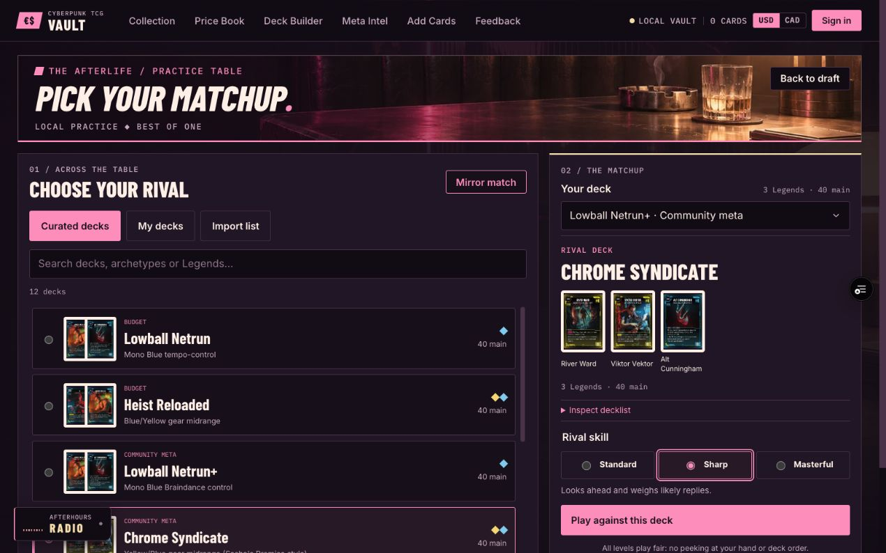

# Practice opponent library and AI audit

11 November 2026. Scope: expand matchup selection and verify existing Standard,
Sharp, and Masterful strategies. This release does not change game rules, add
progression, or claim tournament-level AI.

## Matchups

- All 12 curated lists, with their actual 40–50-card main decks and Legend crews.
- Saved decks, including lists needing repair; exact issues block match creation.
- Pasted/uploaded Vault, Melee, or NetDeck text; unknown lines, ambiguous variants,
  duplicate Legends and extra Legend copies cannot silently become a different list.
- Mirror matches and independent selection of the player's current draft, saved deck,
  or curated list. A match owns copies of both decks; original saved lists and an
  existing unsaved builder draft remain unchanged.
- Deck Builder's More menu, Meta Intel curated cards, and shared deck pages offer
  **Play against this deck** on desktop. The handoff requires choosing the player's deck.
- Full deck validation includes the sideboard, but only crew/main enter best-of-one.
  A generated engine manifest catches unsupported cards before opening a worker.
- Existing autosave, recovery, and active-match replacement confirmation remain in use.

## Concrete AI correction

The tactical strategies could simulate calling a shuffled, face-down Legend and
choose the slot based on its hidden identity. The upstream search also explicitly
allowed the bot to inspect its own unknown deck top when evaluating certain
abilities. A filtered initial view alone did not prevent these speculative leaks.

`fair-tactical-search.patch` ends evaluation at newly exposed concealed identities,
removes the own-deck exception, and prevents post-search bonuses/stall probes from
reading those outcomes. Visible-board tactics retain their existing lookahead.
Actual moves still resolve normally, and saved matches keep their original state
and random streams. The next AI decision in an older saved match uses the corrected
strategy and can therefore differ from a pre-update run.

Regression tests cover concealed-identity and deck-order invariance, sampled midgame
positions, a deck-reveal ability, no live-state mutation during search, choosing a
winning seventh Gig, and selling unusable Gear to fund a Unit. Existing repeatable
match, rules, resume and presentation tests also pass.

## Reproducible match sweep

Run `node scripts/benchmark-rivals.mjs /tmp/rivals.json` from the repository root.
The [recorded results](qa/opponent-benchmark.json) include every seed, matchup, outcome and command count.
Optional `BENCH_DECK` and `BENCH_SKILL` environment variables narrow a rerun.

Each curated list is tested at all three skills, once per seat, against the list
five positions later in the curated roster playing Standard. Seeds are fixed per
list and seat. There are 72 games per sweep; this is a coverage/latency smoke test,
not a calibrated rating or proof of optimal tactics.

| Strategy | Before correction: wins / 24 | After correction: wins / 24 | Slowest decision in isolated rerun |
| --- | --- | --- | --- |
| Standard | 12 | 12 | 5 ms |
| Sharp | 22 | 21 | 358 ms |
| Masterful | 22 | 21 | 376 ms |

All 72 games completed without rejected moves or stalls before and after the fix.
A second post-fix sweep produced identical winners, command counts and move totals
for every seed. Timing was measured in the development container, not a browser
performance guarantee. The first concurrent test run had scheduling outliers up to
6.7 seconds; an isolated rerun removed them. Sharp and Masterful tied here, so this
sample does not establish a reliable strength gap between those two levels.

The benchmark uses generic policies for arbitrary legal lists; it does not add a
bespoke strategy for every imported deck or establish exhaustive combination coverage.

## Browser verification

Verified the deployed preview in Chrome: curated search and empty results; Meta Intel
and Deck Builder opponent handoffs; player-deck selection; saved rivals; invalid
imports blocking Start; valid imports with a seven-card sideboard; edits invalidating
an earlier preview; imported match startup and same-hand recovery after reload;
mirror startup; replacement cancellation preserving the live match and unsaved draft;
and keyboard navigation through source tabs and skill choices. No console errors
were observed in those flows. The compact layout puts the complete Start action
within the first 800 CSS pixels at a 1280-wide desktop viewport.

The uploaded-file picker and signed-in cloud account were not exercised in the
browser pass; imports use the same tested text parser, and saved-deck access uses
the existing store. The rules audit remains the separate source of mechanics coverage.
