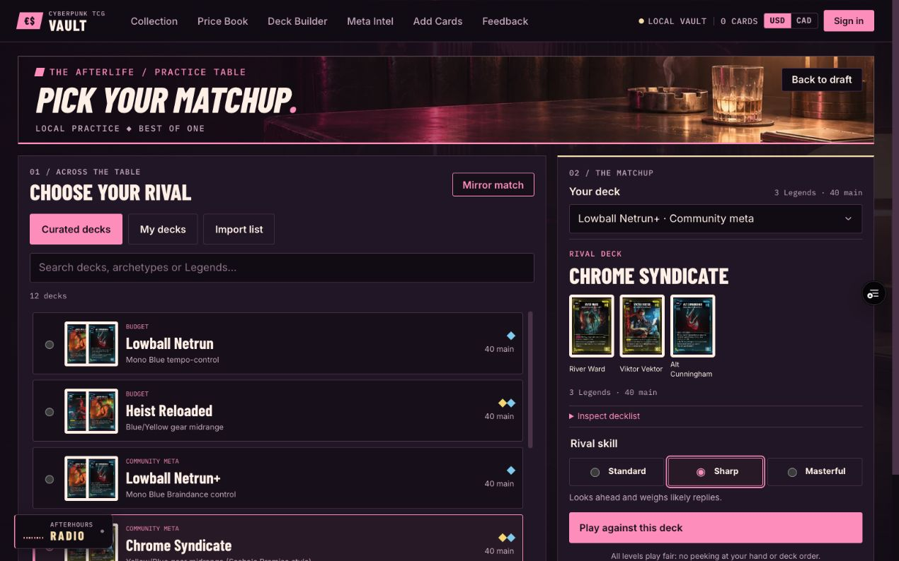

# Practice opponent library and AI audit

11 November 2026. Scope: expand matchup selection and verify existing Standard,
Sharp, and Masterful strategies. This release does not change game rules, add
progression, or claim tournament-level AI.

## Matchups

- All 12 curated lists, with their actual 40–50-card main decks and Legend crews.
- Saved decks, including lists needing repair; exact issues block match creation.
- Pasted/uploaded Vault, Melee, or NetDeck text; unknown lines, ambiguous variants,
  duplicate Legends and extra Legend copies cannot silently become a different list.
- Mirror matches and independent selection of the player's current draft, saved deck,
  or curated list. A match owns copies of both decks; original saved lists and an
  existing unsaved builder draft remain unchanged.
- Deck Builder's More menu, Meta Intel curated cards, and shared deck pages offer
  **Play against this deck** on desktop. The handoff requires choosing the player's deck.
- Full deck validation includes the sideboard, but only crew/main enter best-of-one.
  A generated engine manifest catches unsupported cards before opening a worker.
- Existing autosave, recovery, and active-match replacement confirmation remain in use.

## Concrete AI correction

The tactical strategies could simulate calling a shuffled, face-down Legend and
choose the slot based on its hidden identity. The upstream search also explicitly
allowed the bot to inspect its own unknown deck top when evaluating certain
abilities. A filtered initial view alone did not prevent these speculative leaks.

`fair-tactical-search.patch` ends evaluation at newly exposed concealed identities,
removes the own-deck exception, and prevents post-search bonuses/stall probes from
reading those outcomes. Visible-board tactics retain their existing lookahead.
Actual moves still resolve normally, and saved matches keep their original state
and random streams. The next AI decision in an older saved match uses the corrected
strategy and can therefore differ from a pre-update run.

Regression tests cover concealed-identity and deck-order invariance, sampled midgame
positions, a deck-reveal ability, no live-state mutation during search, choosing a
winning seventh Gig, and selling unusable Gear to fund a Unit. Existing repeatable
match, rules, resume and presentation tests also pass.

## Reproducible match sweep

Run `node scripts/benchmark-rivals.mjs /tmp/rivals.json` from the repository root.
The [recorded results](qa/opponent-benchmark.json) include every seed, matchup, outcome and command count.
Optional `BENCH_DECK` and `BENCH_SKILL` environment variables narrow a rerun.

Each curated list is tested at all three skills, once per seat, against the list
five positions later in the curated roster playing Standard. Seeds are fixed per
list and seat. There are 72 games per sweep; this is a coverage/latency smoke test,
not a calibrated rating or proof of optimal tactics.

| Strategy | Before correction: wins / 24 | After correction: wins / 24 | Slowest decision in isolated rerun |
| --- | --- | --- | --- |
| Standard | 12 | 12 | 5 ms |
| Sharp | 22 | 21 | 358 ms |
| Masterful | 22 | 21 | 376 ms |

All 72 games completed without rejected moves or stalls before and after the fix.
A second post-fix sweep produced identical winners, command counts and move totals
for every seed. Timing was measured in the development container, not a browser
performance guarantee. The first concurrent test run had scheduling outliers up to
6.7 seconds; an isolated rerun removed them. Sharp and Masterful tied here, so this
sample does not establish a reliable strength gap between those two levels.

The benchmark uses generic policies for arbitrary legal lists; it does not add a
bespoke strategy for every imported deck or establish exhaustive combination coverage.

## Browser verification

Verified the deployed preview in Chrome: curated search and empty results; Meta Intel
and Deck Builder opponent handoffs; player-deck selection; saved rivals; invalid
imports blocking Start; valid imports with a seven-card sideboard; edits invalidating
an earlier preview; imported match startup and same-hand recovery after reload;
mirror startup; replacement cancellation preserving the live match and unsaved draft;
and keyboard navigation through source tabs and skill choices. No console errors
were observed in those flows. The compact layout puts the complete Start action
within the first 800 CSS pixels at a 1280-wide desktop viewport.

The uploaded-file picker and signed-in cloud account were not exercised in the
browser pass; imports use the same tested text parser, and saved-deck access uses
the existing store. The rules audit remains the separate source of mechanics coverage.

## First-pass decision fixes, 16 November 2026

`rival-defense-sequencing.patch` addresses demonstrated defensive and sequencing mistakes:

- All three levels match Alt Cunningham's threatened Gig values to distinct eligible hand cards, choosing the least valuable matching discard. A bounded material estimate can preserve an expensive card early; prevention receives greater weight near a seven-Gig win and during overtime.
- Standard compares Jackie's replacement and payment against the best eligible Unit and its attached Gear. Sharp and Masterful retain their existing search for this choice.
- Sharp and Masterful retain setup and passing alongside eligible fights and direct attacks. The MaxTac AV / Mantis Blades regression now equips to reach 10 power before stealing two Gigs, including when a winning fight is also available. The old campaign-only setup exception is unnecessary and removed; search budgets are unchanged.
- Opening those candidates exposed an indirect information leak in speculative attacks against Alt: whether a prevention prompt appeared depended on the concealed hand. Search now cuts off from the public pre-action position whenever that defense could apply. It does not inspect whether a matching discard actually exists. Effect choices that might reach prevention use the same conservative boundary.

These are decision-policy changes, not changes to card rules. Checked against the official current English text for [Alt Cunningham: Mother of Daemons](https://cyberpunktcg.com/cards/alt-cunningham-mother-of-daemons) and [Jackie Welles: Mama's Favorite](https://cyberpunktcg.com/cards/jackie-welles-mama-s-favorite), plus the [Comprehensive Rules](https://cyberpunktcg.com/comprehensive-rules) sections on stealing and replacement effects. The official indexed rules illustrate both equal-cost discard prevention and the extra Gig at 10 power; the live rules-reader API was inaccessible from this environment, so this pass does not claim a new exhaustive rules-version audit.

Fourteen added regression cases cover equipment sequencing, legal distinct discards, expensive-card retention versus stopping seven Gigs, Jackie's accept/decline tradeoff, and unchanged attack/steal decisions when Alt's concealed matching card changes. Existing tests cover repeatability, match recovery, rules, and broader hidden-information invariance.

Remaining work is unchanged: revealed-card selection, remembered private Legend information, substantive Masterful differentiation, and deliberate difficulty variation are outside this pass. The defensive valuations remain heuristics; the conservative Alt cutoff also limits lookahead in those positions. Neither these fixes nor a small fixed matchup sweep establish tournament-level play.

Validation: `npm run check` passes all 578 tests, lint (existing warnings only), typechecking, and production build. `npm run check:budget` passes. Additional sampled probes found no mismatches across 756 concealed-card comparisons, 288 hidden-RNG comparisons, and 36 Alt-specific comparisons. These finite checks are evidence, not proof of exhaustive fairness.

The [first-pass sweep](qa/opponent-first-pass-benchmark.json) covers the current 17-list roster in both seats, for 102 completed games with no rejected moves or stalls. Standard won 16/34, Sharp 24/34, and Masterful 24/34. The same fixed sweep before this pass was 16/34, 27/34, and 27/34 respectively. The demonstrated tactical corrections therefore do **not** establish a general strength increase; retain this regression signal for the later evaluation/difficulty pass rather than tuning to these seeds. Timing in this artifact overlaps other checks and is not an isolated latency benchmark.

## Informed choices and planning, 16 November 2026

The second phase replaces list-order decisions for revealed cards with bounded contextual evaluation. Searches respect their legal destination/cardinality lists, prefer usable Units when a board needs development, consider Gear hosts and power thresholds, and preserve useful cards when selecting a mandatory trash. Fool on the Hill compares the revealed cards with a generic value for unknown replacement draws. Misty uses the bot's own registered deck composition as a prior; it does not inspect current deck contents or order. Gain-a-Gig choices average legal die faces, including visible Gig-condition opportunities for Sharp and Masterful.

Private Legend knowledge now has a saved snapshot, separate from the authorization map. Only actual reveal events populate it. Search receives the deciding seat's remembered identities, never another seat's observations or a fork's new reveals. Remembered slots retain public face-down/spent status; the bot can avoid repeatedly inspecting the same Legend and can use known identities when planning a call. Shuffling clears those associations, leaving the Legend area prunes them, and reloads retain them. Old saves with the earlier authorization-only format hydrate their explicitly known slots once.

Masterful now applies a capped public ability-fit adjustment to primary scores, rather than only breaking exact ties. Its searches use depth four and 96 nodes, prioritize promising candidates, reserve work for replies, and share the remaining work among root candidates. Sharp remains at depth three / 48 nodes. The targeted Kiroshi fixture values repeatable information over surplus Gear power; established combat-setup and winning-Gig cases remain covered. This creates a substantive policy difference, but does not by itself establish a reliable strength gap.

Broader validation found an additional shared-search leak: a simulated combat reaction prompt could disclose a concealed QUICK card. Search now stops at attack declaration whenever a rival's nonempty hidden hand could contain a response. A reproducible sampled-position regression covers both tactical levels. This boundary sacrifices some combat lookahead rather than assuming knowledge of a hidden response.

Verified the official current English texts for [Kiroshi Optics](https://cyberpunktcg.com/cards/kiroshi-optics), [Three Mouths, One Desire](https://cyberpunktcg.com/cards/three-mouths-one-desire), [Fool on the Hill](https://cyberpunktcg.com/cards/fool-on-the-hill), and [Misty Olszewski](https://cyberpunktcg.com/cards/misty-olszewski-mender-of-broken-spirits). Their legal choices and mechanics are unchanged. The [Comprehensive Rules](https://cyberpunktcg.com/comprehensive-rules) remain the authority for private information, searching, and rolling dice.

The benchmark now carries registered own-deck priors and actual seat-scoped peek memory, matching the session adapter. `BENCH_OPPONENT_SKILL=sharp BENCH_SKILL=masterful BENCH_SEED_PREFIX=vault-ai-holdout-v1 node scripts/benchmark-rivals.mjs /tmp/head-to-head.json` runs a direct comparison on a separate seed family. The default command still runs all three levels against Standard. Because every difficulty receives choice improvements, comparisons with previous releases are not a controlled measurement of one isolated change.

Deliberate imperfection and human calibration remain separate work. Card-choice utility and replacement-draw value are estimates; the deck-type prior does not track every card that has left the original list. A small fixed matchup suite cannot certify regional-tournament strength.

Validation: `npm run check` passes all 599 tests, lint with existing warnings only, typechecking, and the production build. The bundle budget remains 267.7 kB gzip initial JS and 17.9 kB CSS. Twenty new regression cases cover choices, memory, planning, and the concealed QUICK boundary; the old seed-dependent worker search test is replaced with two explicit per-seat search fixtures. Regenerating the vendor module produces an identical hash.

Additional sampled probes found zero mismatches across 756 concealed-card comparisons, 288 hidden-RNG comparisons, and 36 Alt-prevention comparisons. Sharp and Masterful chose different moves in 14/126 sampled positions; that measures policy separation, not whether every difference improves play.

The [second-phase roster results](qa/opponent-informed-planning-benchmark.json) contain all 102 games, completed without rejected moves or stalls. Wins out of 34 against the updated Standard were Standard 15, Sharp 26, Masterful 27. The preceding release's corresponding counts were 16, 24, 24. These are fixed, small samples and all opponents changed; the one-win Sharp/Masterful difference is not a reliable strength estimate. Timing overlaps other validation and is not an isolated browser-latency measurement.

The [direct Masterful-versus-Sharp comparison](qa/opponent-masterful-sharp-benchmark.json), using the separate `vault-ai-holdout-v1` seed family, completed all 34 games without rejected moves or stalls. Masterful won 20/34. This is encouraging directional evidence, not a statistically established ranking or evidence of regional-tournament strength. No deliberate randomness or handicaps were added to the lower difficulties.

## Coach and opponent decision baseline

Measured on the planners from `129884f`. Run `node scripts/benchmark-planner.mjs /tmp/planner.json docs/qa/planner-decision-baseline.json` from the repository root. The [recorded decisions and timings](qa/planner-decision-baseline.json) include the local coach’s line and alternative, and the first legal command chosen by each rival strategy from the same seat. The reference argument checks that every position has the same inputs before writing the new report. The hash covers the deciding player’s filtered position and registered deck-type counts.

| Decision | Observed result |
| --- | --- |
| Ripper, before equipping | The coach recommends Radioport, Faceplate, then attack. Its alternative opens with Faceplate. Masterful opens with Radioport. Standard and Sharp open with Faceplate. |
| Ripper, after paying for Radioport | All four choose Faceplate. With BBG passing, both lines steal the d4. Attacking immediately leaves 2 €$ and Faceplate in hand. Buying Faceplate leaves 0 €$, permits a die adjustment, and draws no card on this attack. |
| MaxTac AV, with a spent rival Unit and three rival Gigs | All four equip Mantis Blades. The existing engine regression plays out the 8-to-10 power increase and two-Gig steal. |
| Opening hands | All four keep the mixed-cost starter hand and mulligan the hand of three Johnny Silverhands and three MaxTac AVs. |
| Gain a Gig | All four choose the d12 from the opening die prompt. |
| Defend a direct attack | The coach, Standard and Masterful start with Floor It. Sharp calls its first Legend slot. This records a difference in approach. Its value depends on the ensuing combat. |
| Win in overtime | From six Gigs each, all four attack the rival over a spent Unit. Resolving the steal wins the game through overtime majority. |

The Ripper position comes from three engine-played turns. The public cards, hand and deck counts, Gig faces, available currency and first equipment payment match the report. The original save and private YYR list were unavailable. The reconstruction uses the curated Smasher/River/Viktor deck with two Secondhand Bombus and one Rockn’ Rockerboy replacing two 6th Street Recruits and one MaxTac Suppression Team. BBG uses its curated list. The fixture assumes its spent first Legend is Jackie Welles and that the player sold on turn one. The MaxTac and overtime cases use staged combat positions shared with the rules regressions.

Timing uses one warm-up and the median of five fresh runs per case and policy. The coach measurement covers a complete local plan. Opponent measurements cover one local decision with automatic payment. Setup, result labeling, command validation, network requests and Gemini narration are outside the timed region. Browser latency and comparative playing strength need separate measurements.

## Comparing equipment with an immediate attack

On the reconstructed YYR versus BBG turn, the coach, Sharp and Masterful now equip Radioport and attack with Sketchy Ripper. At 2 power, Ripper can already steal BBG’s only d4 if the attack connects. Faceplate would spend the remaining 2 €$ before Ripper’s search and Radioport’s peek. The player owns only two Gigs when the spend trigger resolves, so Faceplate can adjust a die but cannot draw on this attack. Standard still chooses Faceplate in the post-Radioport position. [Fixed-position results](qa/planner-commitment-search.json)

Two comparisons check when the second purchase earns its cost. Give the player a third Gig with a distinct value and the coach equips Faceplate before attacking, enabling the draw. With MaxTac AV at 8 power and three Gigs available to steal, all four policies buy Mantis Blades to reach 10 power and threaten a second Gig. The timing and thresholds follow the [Comprehensive Rules, §9.20](https://cyberpunktcg.com/comprehensive-rules), [Faceplate](https://cyberpunktcg.com/cards/zetatech-faceplate), and [Radioport](https://cyberpunktcg.com/cards/arasaka-emergency-radioport).

The tactical search compares equipping and attacking with the same host within its existing search budget. It counts Gear power on its host once, caps immediate steals at the rival’s Gig count, and gives retained buying power a bounded value when an attack can reveal new choices. If a concealed response, Legend Call, or eligible draw, peek, or search could intervene, it scores the declaration using the deciding seat’s view. Tests change the concealed rival response, deck order, face-down crew and RNG, then compare the resulting decisions.

Two runs reproduced the decisions across all eight baseline positions. The roster sweep completed 114 games, covering all 19 lists in both seats at each difficulty against Standard. Sharp and Masterful each won 32 of their 38 games. Comparing the strength of those two levels requires the separate difficulty-calibration phase.
